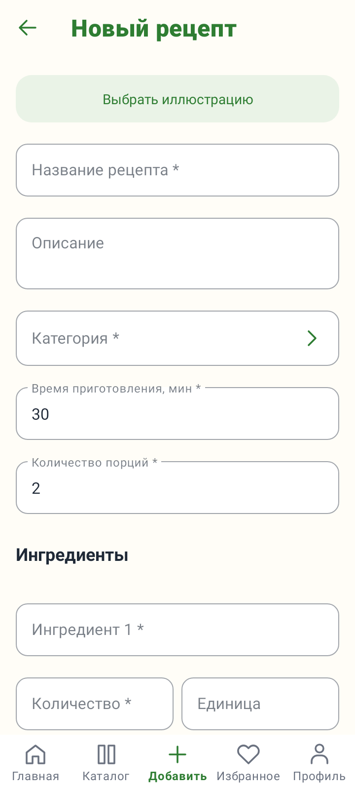
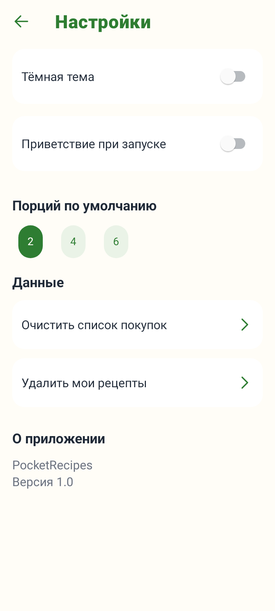
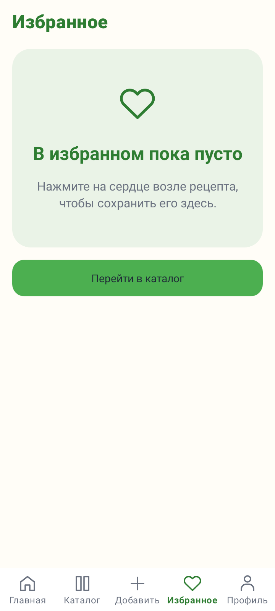

# PocketRecipes

Локальная книга рецептов для Android по лабораторной работе №2. Приложение помогает выбрать блюдо, найти его по названию и категории, сохранить в избранное и перенести ингредиенты в список покупок.

Пользователь может создавать, редактировать и удалять собственные рецепты. Рецепты, избранное и покупки сохраняются в Room; имя, тема, число порций и состояние первого запуска - в SharedPreferences. Регистрация и интернет не нужны.

## Макет

[Figma](https://www.figma.com/design/Ahw6YHladgJRPbiQvpQp5c) · [Исходный прототип Screens](https://www.figma.com/proto/Ahw6YHladgJRPbiQvpQp5c?node-id=5-2061)

Палитра: #4CAF50, #2E7D32, #FFFDF7, #FFB74D. Шрифт - системный Roboto, базовый макет 360 × 800 dp. Фотографии восьми блюд находятся в res/drawable-nodpi (JPG, PNG, WebP). Карточки и экран рецепта показывают их с заполнением области без искажения пропорций. В форме доступен выбор из этих восьми фото с миниатюрами; доступ к галерее телефона не требуется. Сохранённые рецепты сохраняют свой выбор изображения.

## Возможности и экраны

1. Приветствие первого запуска.
2. Главная: популярные и недавно созданные рецепты.
3. Каталог: восемь стартовых блюд и пользовательские рецепты.
4. Категории и количество рецептов.
5. Поиск по названию, категориям и времени.
6. Рецепт: описание, ингредиенты и пошаговое приготовление.
7. Создание рецепта с динамическими строками ингредиентов и шагов.
8. Редактирование собственного рецепта и подтверждение удаления.
9. Мои рецепты.
10. Избранное.
11. Покупки: ручное добавление, перенос ингредиентов, отметка купленного и удаление.
12. Профиль: имя, реальная статистика, переходы.
13. Настройки: светлая/тёмная тема, приветствие, порции, очистка данных.

Показаны пустые списки, пустой поиск, отсутствие результатов, загрузка, ошибки формы, отключённая кнопка сохранения и сообщения об успешных действиях. Черновик рецепта сохраняется при пересоздании Activity, включая поворот экрана.

## Технологии

- Kotlin для UI, Repository и ViewModel; Java для Room entities/DAO и Database.
- XML-разметка, Material Components, Fragments, Navigation Component.
- RecyclerView для рецептов и покупок.
- Room: таблицы recipes, ingredients, steps, shopping, внешние ключи и каскадное удаление.
- LiveData, ViewModel, SavedStateHandle, фоновый executor.
- Android 7.0+ (minSdk 24), compile/target SDK 37, версия приложения 1.0.
- Существующие версии проекта сохранены: Android Gradle Plugin 9.4.1, Gradle 9.6.0. JDK 25 - согласно gradle-daemon-jvm.properties.

Room-описания находятся в Java, поэтому генерация DAO использует annotationProcessor. Kotlin поддерживается встроенным компилятором AGP 9.

## Запуск в Android Studio

1. Откройте папку проекта.
2. Проверьте Android SDK 37 и путь к SDK в local.properties.
3. В настройках Gradle выберите JDK 25 из Android Studio (jbr).
4. Дождитесь Gradle Sync.
5. Выберите модуль app, устройство Android 7.0+ или эмулятор и нажмите Run.

## Сборка на Windows

Из корня проекта:

~~~powershell
powershell -ExecutionPolicy Bypass -File scripts/build.ps1
~~~

Скрипт размещает кеш Gradle и временные файлы на диске проекта, чтобы не заполнять C:.
Он выполняет assembleDebug, testDebugUnitTest, assembleDebugAndroidTest и lintDebug.

APK: app/build/outputs/apk/debug/app-debug.apk.

Тесты на подключённом устройстве:

~~~powershell
.\gradlew.bat connectedDebugAndroidTest
~~~

## Структура

- MainActivity, PocketApp - точка входа и навигация.
- data/ - Room, репозиторий и стартовые рецепты.
- model/ - модель формы и независимая валидация.
- ui/ - фрагменты, ViewModel, общие элементы, адаптеры и иллюстрации.
- res/layout, res/navigation, res/menu - XML.
- test/ - проверки валидации, Room, навигации, формы и рендеринга через Robolectric.
- androidTest/ - проверки базы и интерфейса на устройстве.

## Изображения экранов

| Новый рецепт |
| --- |
|  |

| Настройки | Пустое избранное |
| --- | --- |
|  |  |
